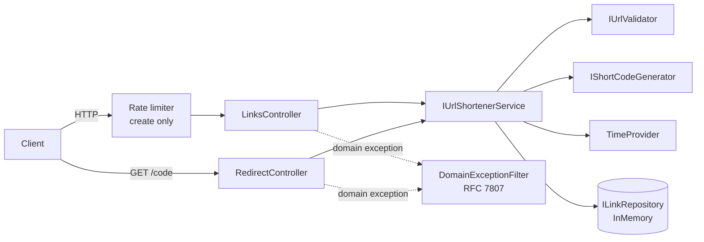
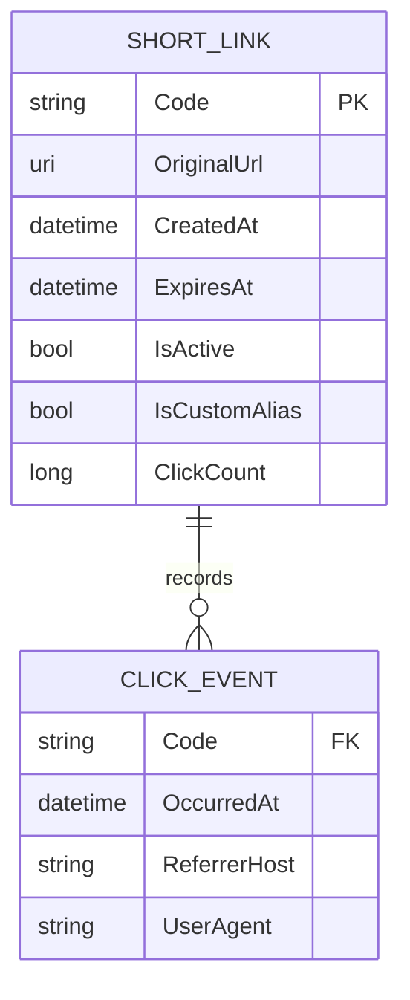

# Architecture (Phase 1)

## Components

* **Controllers** are thin. They do HTTP mapping only.
* **Service** owns the business rules: validation order, alias rules, collision retry, expiry, click recording.
* **Repository** owns storage and the atomic uniqueness guarantee (`TryAdd`).
* **TimeProvider** (built into .NET 8) is injected, so time-based rules are testable.
* All registrations live in `ServiceCollectionExtensions.AddUrlShortener`, which is the single composition root.
  Store, generator and validator are singletons (stateless or thread-safe). The service is scoped.

## Control flow
**Create:** validate URL (scheme, length, credentials, private host) → validate expiry → if alias: format and reserved-word
check, then `TryAdd` (409 on conflict) → otherwise generate code, `TryAdd`, and retry up to N times on collision (503 if exhausted).

**Redirect:** route constraint `^[A-Za-z0-9_-]{3,32}$` → lookup (404) → active? (410) → expired? (410) → atomic click
increment + click event → 302 with `no-store`.

## Data model

## Key decisions (ADR summary)
| # | Decision | Why | Alternative rejected |
|---|---|---|---|
| ADR-1 | Crypto-random Base62, 7 chars | Not enumerable. ~3.5×10¹² keyspace. Simple | Sequential counter + Base62: guessable, needs a central counter |
| ADR-2 | Uniqueness by atomic insert, not check-then-insert | A check-then-insert races under concurrency (the brownfield bug) | Lock around generate+insert: serialises writes |
| ADR-3 | 302 + `Cache-Control: no-store` | Accurate analytics. Deactivation is honoured | 301: browsers cache it forever |
| ADR-4 | Exceptions for domain failures, mapped by an MVC filter | Keeps services clean. One mapping table. Expected 4xx not logged as errors | Result<T> types: more ceremony for a prototype |
| ADR-5 | In-memory store behind `ILinkRepository` | Zero setup ("simple mode"). Swappable | EF Core + SQLite: more moving parts for the prototype |
| ADR-6 | Built-in ASP.NET Core rate limiter, per IP, create only | No extra dependency. Redirects stay unthrottled | Global limit: would hurt legitimate redirect traffic |
| ADR-7 | Store referrer **host** only, no IP | Useful insight, minimal personal data | Full referrer URL and IP: privacy risk |
