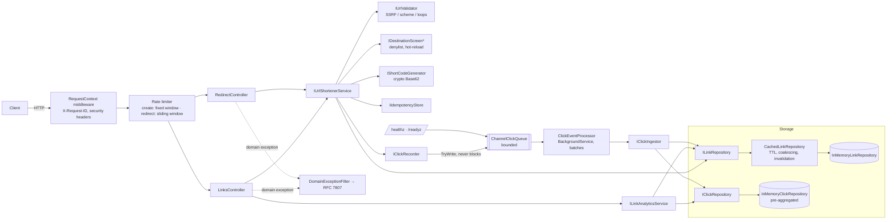
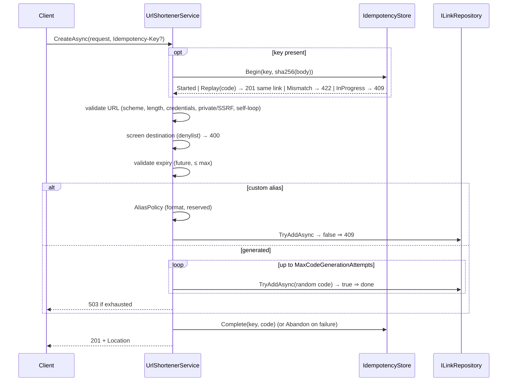
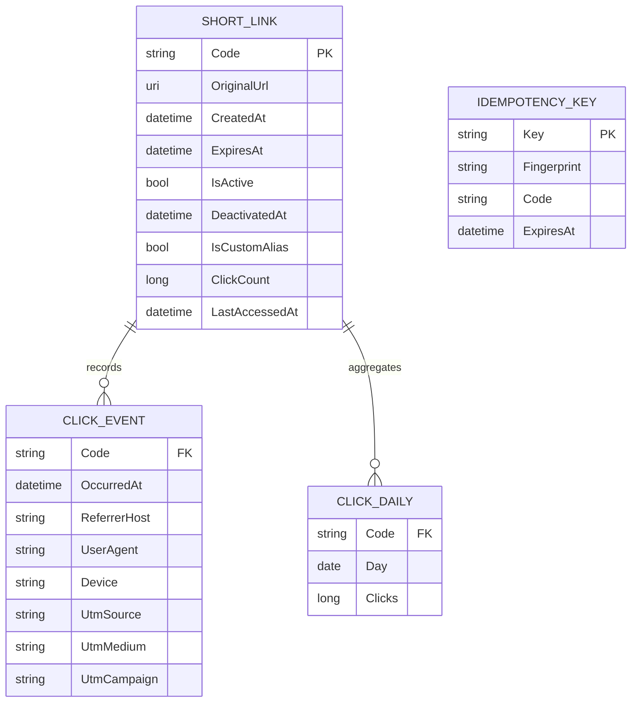

# Architecture (Phase 1)

## Components

* **Controllers** are thin: HTTP mapping only.
* **`UrlShortenerService`** owns lifecycle rules (validation order, aliases via `AliasPolicy`, collision retry, expiry, screening, idempotency).
* **`LinkAnalyticsService`** owns the read side (stats, daily series), split out for single responsibility.
* **Repositories** own storage and the atomic uniqueness guarantee. Links and clicks are separate interfaces so they scale independently.
* **Decorators** (`CachedLinkRepository`, `LatencyInjecting*`) are composed only in `ServiceCollectionExtensions.AddUrlShortener`,
  the single composition root. Services never know about caching.
* Lifetimes: stores, cache, queue, validator, screens and generator are singletons (thread-safe); services are scoped.

## Execution approach
Engineer-led, AI-assisted, phase-gated (see `URL_Shortener_AI_Prompt.md`): requirements → architecture/ADRs → task list → one task per
reviewable change with tests → quality gates → AI_LOG entry → engineer review. Decisions are recorded in `docs/DECISIONS/`.

## Control flow
**Create** (`POST /api/v1/links`):

**Redirect** (`GET /{code}`): route constraint `^[A-Za-z0-9_-]{3,32}$` → rate limit → `GetByCode` (cache) → 404 → inactive? 410 →
expired? 410 → denylisted now? 410 → build `ClickEvent` (referrer host, device class, UTM) → `queue.TryWrite` (O(1), no I/O) → 302 `no-store`.
The background processor then batches: one counter update per link + one bulk insert.

## Data model

Aggregates (by day, referrer, UTM, device) are maintained on write, so stats reads cost O(dimensions), not O(clicks).
Raw events are kept in a bounded window per link.

## API contract (OpenAPI at `/swagger`, XML-documented)
| Method | Route | Success | Errors |
|---|---|---|---|
| POST | `/api/v1/links` (+ optional `Idempotency-Key`) | 201 | 400, 409, 422, 429 |
| GET | `/api/v1/links/{code}` | 200 | 404 |
| GET | `/api/v1/links/{code}/stats?top=5` | 200 | 404 |
| GET | `/api/v1/links/{code}/stats/daily?from=&to=` | 200 | 400, 404 |
| DELETE | `/api/v1/links/{code}` | 204 | 404 |
| GET | `/{code}?utm_source=&utm_medium=&utm_campaign=` | 302 | 404, 410, 429 |
| HEAD | `/{code}` | 302 (not counted) | 404, 410 |
| GET | `/healthz`, `/health` (alias), `/readyz` | 200 | 503 when unhealthy |

## Short-code strategy
Crypto-random Base62 of length 7 vs counter: see ADR-001 (collision maths, enumerability, scaling).

## Caching strategy
Cache-aside on the link lookup only (the redirect hot path); see ADR-005. TTL 60 s capped by link expiry, request coalescing,
5 s negative cache, eviction on deactivate, size-bounded. Stats are not cached (they are pre-aggregated already).

## Failure modes
| Failure | Effect | Handling |
|---|---|---|
| Store slow | Redirect latency ↑ on cache misses only | Cache hit path has no I/O; analytics async |
| Store down | Misses fail (500, generic problem), cached links keep redirecting up to TTL | Readiness/alerts; production: circuit breaker |
| Analytics store slow/down | Queue fills → events dropped, redirects unaffected | `/readyz` Degraded at 90 %; `dropped` counter |
| Batch write throws | That batch lost, pipeline continues | Logged with count; production: retry + DLQ |
| Process crash | Queued events (≤ capacity) lost | Documented; durable queue in production |
| Code space contention | Retry, then 503 | ADR-001 maths: practically unreachable |
| Hot key | Single cache entry, coalesced loads | Stampede test |
| Flood / enumeration | 429 per IP | Two limiters; forwarded headers from known proxies only |
| Bad config | App refuses to start | `ValidateOnStart` |
| Denylisted after creation | 410 at redirect | Screen runs on every redirect, hot reload |

## Key decisions (summary, details in `docs/DECISIONS/`)
| ADR | Decision |
|---|---|
| 001 | Crypto-random Base62, 7 chars |
| 002 | Uniqueness by atomic insert + retry |
| 003 | 302 + no-store; HEAD not counted |
| 004 | Async, batched click recording (Channel + BackgroundService) |
| 005 | Cache-aside decorator with TTL, coalescing, invalidation |
| 006 | In-memory store behind async, split repositories |
| 007 | Privacy: no IPs, referrer host, bounded values |
| 008 | Domain exceptions → RFC 7807 via MVC filter |
| 009 | SSRF validator, denylist hook, two rate limits |
| 010 | Idempotent create via `Idempotency-Key` |
